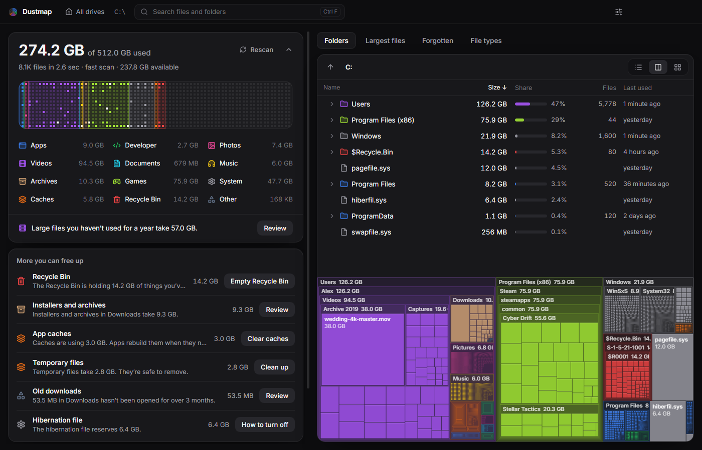
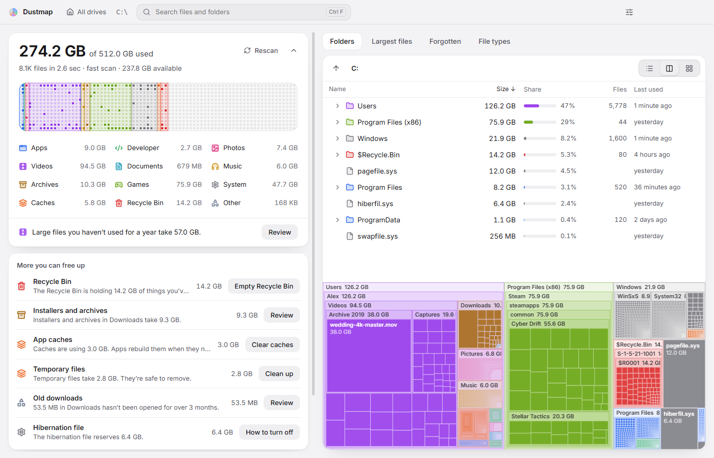

<p align="center">
  
</p>

<h1 align="center">Dustmap</h1>

<p align="center">
  <b>See what fills your disk, find what’s gathering dust, and clean up safely.</b><br>
  A fast, open-source disk space analyzer for Windows and macOS.
</p>

<p align="center">
  <a href="https://github.com/wasti4/dustmap/releases/latest"></a>
  <a href="https://github.com/wasti4/dustmap/releases"></a>
  <a href="https://github.com/wasti4/dustmap/actions/workflows/ci.yml"></a>
  
  <a href="LICENSE"></a>
</p>

<p align="center">
  <a href="../../releases/latest"><b>Download Dustmap</b></a> ·
  <a href="README.ru.md">Русский</a> ·
  <a href="CONTRIBUTING.md">Contributing</a> ·
  <a href="CHANGELOG.md">Changelog</a>
</p>

https://github.com/user-attachments/assets/4b7f5ba1-2586-428c-8a0b-e1f1628578ff

<p align="center"><sub>A real, unedited scan of a system drive with 877 thousand files, without administrator rights. Personal folder names are masked.</sub></p>

## Why Dustmap

- **Fast disk scans.** About 7 seconds for the benchmarked Windows system drive, or 3.4 seconds in NTFS turbo mode. macOS reads file metadata in bulk on APFS.
- **Finds what you forgot.** Large files and whole folders nobody has opened for months, sorted by size.
- **Cleans up safely.** The Recycle Bin or Trash is the default destination. System folders are protected, and you see the selected size before you confirm.

## Screenshots

<table>
  <tr>
    <td></td>
    <td></td>
  </tr>
</table>

## Features

- **Fast scans.** Native helpers read directory metadata in bulk through `NtQueryDirectoryFile` on Windows and `getattrlistbulk` on macOS. You can scan a drive or a specific folder.
- **Turbo mode (NTFS MFT).** Run as administrator and Dustmap reads the NTFS Master File Table directly in one sequential pass. It sees protected folders and counts hard links once, so the total matches the drive’s used space.
- **Storage widget.** A dot-matrix bar split into twelve categories fills up live while scanning, explains each category on hover and dissolves into particles when you free space.
- **Smart categories.** Folders give context first (system directories, apps, user caches, `node_modules`, Steam libraries and game data), file extensions second.
- **Cleanup suggestions.** Recycle Bin, app caches, temporary files, dependencies and build output of inactive projects (`node_modules`, `target`, `bin/obj`…), old installers and downloads, large files unused for a year, `Windows.old`, the hibernation file.
- **Forgotten files.** Filter by last use (3 months to 3 years), size and category. Smart groups show whole forgotten folders instead of thousands of single files.
- **Explorer and treemap.** A folder tree sorted by size, with shares and last-used dates, next to a squarified treemap. Selection is shared between them.
- **Largest files, file types and search.** `*.mp4` searches by extension.
- **Safe by default.** Each cleanup shows its selection before you confirm. The main process protects system paths, and cache cleanup keeps the cache directory in place. On macOS, close the affected apps before clearing their caches.
- **Languages and themes.** English, Russian, Chinese and Spanish; dark and light themes with an animated switch. Both follow the system by default.
- **Accessible.** Full keyboard control, ARIA roles, screen reader announcements and a reduced-motion mode.
- **Private.** Works offline. No accounts, no telemetry.


## Download

Get the latest build from [Releases](../../releases/latest):

- `Dustmap-Setup-x.y.z.exe`: installer with a Start menu shortcut
- `Dustmap-x.y.z-portable.exe`: a single file, no installation

- `Dustmap-x.y.z-mac-arm64.dmg` for Apple Silicon
- `Dustmap-x.y.z-mac-x64.dmg` for Intel

Dustmap requires 64-bit Windows 10 or 11, or macOS 13 Ventura or later. On Mac, open the disk image and drag Dustmap to Applications. Test images from GitHub Actions are ad-hoc signed and may require approval in Privacy & Security. Developer ID-signed and notarized images can be distributed normally.

Windows SmartScreen may warn about the current Windows builds. For NTFS turbo mode, start Dustmap as administrator or choose **Restart as administrator** in the app.

### macOS disk access and sizes

Start by scanning a folder or drive. To include folders protected by macOS, grant Dustmap **Full Disk Access** in **System Settings → Privacy & Security** and reopen it. Dustmap reports entries it cannot read.

The startup scan includes the System and Data volumes and skips other mounted volumes, which are available separately. The capacity bar shows space outside the scan separately. APFS clones, snapshots and shared container space can make the space you recover differ from the sizes shown next to files. Emptying Trash applies to your Trash on the selected drive.

## Performance

Measured on a Windows 11 laptop with an NVMe SSD:

| Drive | Fast scan | Turbo (MFT) | Counted vs. used space |
| --- | --- | --- | --- |
| System drive, 1.1 million entries | 6–8 s | 3.4 s | fast 97.6 %, turbo 99.7 % |
| Data drive, 1.7 million entries | 12.5 s cold, 4.2 s warm | 6.4 s | fast 104 % (hard links), turbo 100 % |

## Resource usage

Dustmap tries to stay out of your way:

- Hardware acceleration is off, since the interface is plain 2D. That saves about 300 MB of memory.
- Animations only run while something changes. The bar’s ambient twinkle stops after 15 seconds without input, so an idle window uses no CPU.
- The file index lives in its own process and is released completely when you return to the start screen.
- Drive discovery uses the platform’s native helper when available.
- The package ships only the Chromium language packs it needs and uses maximum compression.

After scanning a profile with 680 thousand entries, all processes together use about 490 MB of private memory, about 300 MB of it for the file index. The installer is 108 MB and the portable build 98 MB; most of that is the Chromium runtime inside Electron.

## Build from source

Use Node.js 24 with Windows 10 or 11, or macOS 13 or later. Xcode Command Line Tools provide the compiler for native scanning and cleanup on Mac.

```sh
npm ci
npm start
```

| Command | What it does |
| --- | --- |
| `npm start` | build and launch the app |
| `npm run dev` | development mode: Vite with hot reload plus Electron |
| `npm run typecheck` | TypeScript type check |
| `npm test` | MFT parser self-test and macOS scanner and cleanup regression checks |
| `npm run bench -- C:\ [--mft]` or `npm run bench -- /Users/me` | scan benchmark in the console (`--mft` needs an administrator terminal) |
| `npm run dist` | build Windows executables on Windows and a disk image for the current architecture on macOS |

`npm start -- --demo` opens the app with a synthetic drive, which is handy for trying cleanup flows without touching real files. Add `--theme=light` or `--lang=es` to force a theme or language. The UI also runs in a plain browser: after `npm run dev`, open the Vite URL with `?scan=C:\` and a demo backend kicks in.

If Electron’s binary is missing after `npm install` (`node_modules/electron/dist` is empty), run `node node_modules/electron/install.js`.

The Windows build uses the C# compiler that ships with Windows. The macOS build uses Xcode's `clang++`. When the helper is unavailable in a development build, the app can still scan using Node.js. Permanent cleanup on macOS uses the bundled native helper.

On a Mac without a Developer ID certificate, `npm run dist -- --publish never -c.mac.identity=-` makes an ad-hoc-signed test disk image. See [release signing](CONTRIBUTING.md#macos-release-signing) for distributable images.

## How it works

```
src/
  main/        Electron main process: window, IPC, Recycle Bin and deletion, elevation
  engine/      scan engine, runs in its own utility process
    fastwalk.ts  driver for the native helper
    walk.ts      portable Node.js walker (fallback)
    mft.ts       NTFS Master File Table reader (turbo mode)
    tree.ts      typed-array tree that holds millions of nodes
    classify.ts  categories from folder context and file extensions
    query.ts     children, treemap, largest and forgotten files, cleanup insights
  native/
    sc-walker.cs Windows directory enumerator and drive lister
    mac-walker.cc macOS metadata scanner, volume lister and cleanup helper
  platform/    macOS volume discovery and protected cleanup paths
  renderer/    React UI: widget, explorer, treemap, lists, dialogs
    lib/locales/ translations
  shared/      types shared by all processes
```

- The engine keeps the whole tree in typed arrays inside a separate process with a larger libuv thread pool, so the window stays responsive with millions of files and queries return only the page the UI needs.
- “Last used” is the latest of opening, modification and creation across everything inside a folder. When Windows doesn’t record file access times (`NtfsDisableLastAccessUpdate`), Dustmap says so and relies on modification dates.

## License

[MIT](LICENSE)
