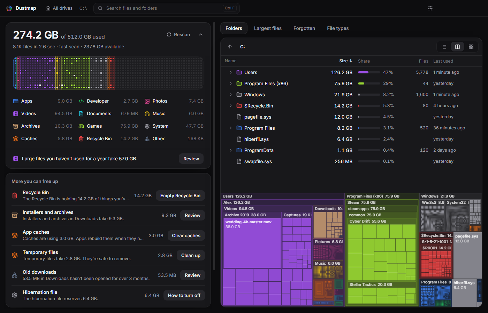
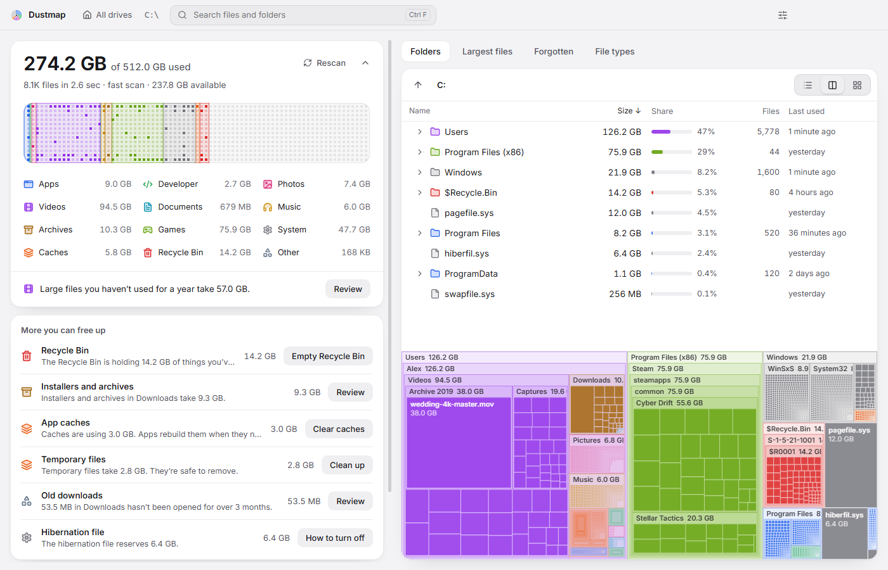

<p align="center">
  
</p>

<h1 align="center">Dustmap</h1>

<p align="center">
  <b>Посмотрите, что заполняет диск, найдите то, что пылится без дела, и безопасно освободите место.</b><br>
  Быстрый анализатор дискового пространства для Windows и macOS с открытым исходным кодом.
</p>

<p align="center">
  <a href="https://github.com/wasti4/dustmap/releases/latest"></a>
  <a href="https://github.com/wasti4/dustmap/releases"></a>
  <a href="https://github.com/wasti4/dustmap/actions/workflows/ci.yml"></a>
  
  <a href="LICENSE"></a>
</p>

<p align="center">
  <a href="../../releases/latest"><b>Скачать Dustmap</b></a> ·
  <a href="README.md">English</a> ·
  <a href="CONTRIBUTING.md">Как помочь проекту</a> ·
  <a href="CHANGELOG.md">Изменения</a>
</p>

https://github.com/user-attachments/assets/4b7f5ba1-2586-428c-8a0b-e1f1628578ff

<p align="center"><sub>Настоящий скан системного диска с 877 тысячами файлов без прав администратора, без монтажа. Названия личных папок скрыты.</sub></p>

## Почему Dustmap

- **Быстро сканирует диски.** Около 7 секунд на системном диске из замеров Windows и 3,4 секунды в турбо-режиме NTFS. На macOS приложение читает метаданные APFS пакетами.
- **Находит забытое.** Большие файлы и целые папки, которые месяцами никто не открывал, отсортированные по размеру.
- **Убирает безопасно.** По умолчанию файлы отправляются в корзину. Системные папки защищены, а размер выбранных объектов виден до подтверждения.

## Скриншоты

<table>
  <tr>
    <td></td>
    <td></td>
  </tr>
</table>

## Возможности

- **Быстрое сканирование.** Нативные обходчики читают метаданные каталогов пакетами через `NtQueryDirectoryFile` на Windows и `getattrlistbulk` на macOS. Можно сканировать диск целиком или выбрать папку.
- **Турбо-режим (NTFS MFT).** С правами администратора Dustmap читает главную таблицу файлов NTFS напрямую, одним последовательным проходом. Видит защищённые папки и считает жёсткие ссылки один раз, поэтому сумма совпадает с занятым местом на диске.
- **Виджет хранилища.** Полоса из точек по двенадцати категориям заполняется прямо во время скана, объясняет категорию при наведении и рассыпается на частицы, когда место освобождается.
- **Умная классификация.** Сначала контекст папки (системные папки, приложения, пользовательские кэши, `node_modules` и библиотеки Steam), потом расширение файла.
- **Подсказки по очистке:** корзина, кэши приложений, временные файлы, зависимости и сборки неактивных проектов (`node_modules`, `target`, `bin/obj`…), старые установщики и загрузки, большие файлы, которыми не пользовались год, `Windows.old`, файл гибернации.
- **«Забытое».** Фильтр по давности использования (от 3 месяцев до 3 лет), размеру и категориям. «Умные группы» показывают целые забытые папки, а не тысячи файлов по отдельности.
- **Проводник и карта.** Дерево папок по размеру с долями и датами использования рядом с treemap; выделение у них общее.
- **Крупные файлы, типы файлов и поиск** (`*.mp4` ищет по расширению).
- **Безопасность по умолчанию.** Перед очисткой видно, какие объекты выбраны. Главный процесс защищает системные пути. Очистка кэша сохраняет саму папку. На macOS перед очисткой кэша закройте соответствующие приложения.
- **Языки и темы.** Русский, английский, китайский и испанский; тёмная и светлая темы с анимированным переключателем. По умолчанию язык и тема берутся из системы.
- **Доступность.** Полное управление с клавиатуры, роли ARIA, объявления для экранного диктора, режим уменьшенных анимаций.
- **Приватность.** Работает офлайн. Без аккаунтов и телеметрии.

## Скачать

Последняя сборка — в разделе [Releases](../../releases/latest):

- `Dustmap-Setup-x.y.z.exe` — установщик с ярлыком в меню «Пуск»
- `Dustmap-x.y.z-portable.exe` — один файл, без установки

- `Dustmap-x.y.z-mac-arm64.dmg` для Apple Silicon
- `Dustmap-x.y.z-mac-x64.dmg` для Intel

Нужна 64-разрядная Windows 10 или 11 либо macOS 13 Ventura и новее. На Mac откройте образ и перетащите Dustmap в «Программы». Тестовые образы из GitHub Actions подписаны ad-hoc. Для их запуска может потребоваться разрешение в разделе «Конфиденциальность и безопасность». Для обычной установки подходят образы с подписью Developer ID и нотариализацией.

Пока Windows-сборки могут показывать предупреждение SmartScreen. Для турбо-режима NTFS запустите Dustmap от имени администратора или нажмите «Перезапустить от администратора» в приложении.

### Доступ и учёт места на macOS

Можно сразу сканировать диск или папку. Чтобы включить папки, защищённые macOS, добавьте Dustmap в «Системные настройки → Конфиденциальность и безопасность → Полный доступ к диску» и откройте приложение заново. Dustmap показывает, сколько объектов прочитать не удалось.

При сканировании загрузочного диска Dustmap учитывает тома System и Data. Остальные подключённые тома можно сканировать отдельно. Клоны, снимки и общий контейнер APFS влияют на то, сколько места реально освободится. Очистка корзины применяется к вашей корзине на выбранном диске.

## Скорость

Замеры на ноутбуке с Windows 11 и NVMe SSD:

| Диск | Обычный скан | Турбо (MFT) | Учтено от занятого |
| --- | --- | --- | --- |
| Системный, 1,1 млн объектов | 6–8 с | 3,4 с | обычный 97,6 %, турбо 99,7 % |
| Диск с данными, 1,7 млн объектов | 12,5 с (холодный), 4,2 с (повторный) | 6,4 с | обычный 104 % (жёсткие ссылки), турбо 100 % |

## Ресурсы

Dustmap старается не мешать работе компьютера:

- аппаратное ускорение выключено — интерфейс состоит из обычной 2D-графики; это экономит около 300 МБ памяти;
- анимации работают, только пока что-то меняется; «мерцание» полосы останавливается через 15 секунд без действий, и в простое окно не тратит процессор;
- индекс файлов живёт в отдельном процессе и полностью выгружается при возврате на главный экран;
- список дисков читается нативным хелпером, без запуска PowerShell;
- в сборке только нужные языковые пакеты Chromium, установщик сжат по максимуму.

После сканирования профиля с 680 тыс. объектов все процессы вместе занимают около 490 МБ закрытой памяти, из них ~300 МБ — индекс файлов. Установщик весит 108 МБ, portable-версия — 98 МБ; основная часть — среда Chromium внутри Electron.

## Сборка из исходников

Нужен Node.js 24. Для компиляции нативного сканера и операций очистки на macOS нужны Xcode Command Line Tools.

```sh
npm ci
npm start
```

| Команда | Что делает |
| --- | --- |
| `npm start` | собрать и запустить приложение |
| `npm run dev` | режим разработки: Vite с горячей перезагрузкой + Electron |
| `npm run typecheck` | проверка типов TypeScript |
| `npm test` | самотест MFT и регрессионные проверки сканирования и очистки macOS |
| `npm run bench -- C:\ [--mft]` или `npm run bench -- /Users/me` | замер скорости сканирования в консоли (`--mft` — из терминала администратора) |
| `npm run dist` | собрать .exe на Windows или .dmg для текущей архитектуры на macOS |

`npm start -- --demo` открывает приложение с синтетическим диском — удобно проверять очистку, не трогая реальные файлы. `--theme=light` или `--lang=es` задают тему и язык. Интерфейс работает и в обычном браузере: после `npm run dev` откройте адрес Vite с `?scan=C:\` — подключится демо-бэкенд.

Если после `npm install` в `node_modules/electron/dist` пусто, выполните `node node_modules/electron/install.js`.

На Windows нативный обходчик компилируется штатным компилятором C#. На macOS используется `clang++` из Xcode. При разработке без нативного обходчика сканирование выполняет Node.js. Для окончательного удаления на macOS нужен нативный компонент из сборки.

## Как это устроено

Структура исходников и подробности — в [английской версии](README.md#how-it-works).

## Лицензия

[MIT](LICENSE)
